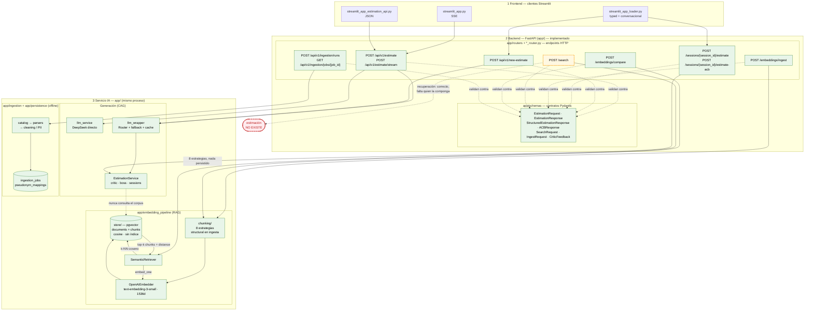
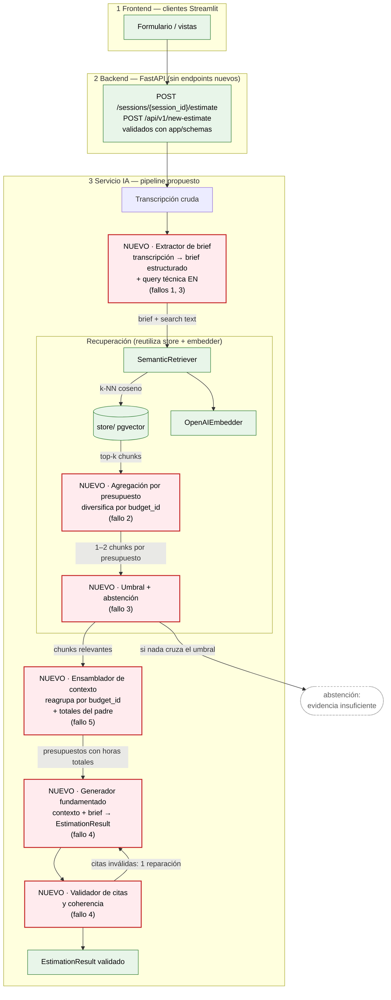

# Diagnóstico arquitectónico — Sesión 09 (pre-work)

Estado del servicio IA al cierre de la Sesión 08, comportamiento observado al
pasarle una transcripción cruda, cinco fallos concretos y propuesta de evolución
hasta cerrar el bucle transcripción → estimación.

> **Cómo está escrito este documento.** Las observaciones van en español; los
> comandos, payloads, nombres de campo e identificadores van en inglés. Todos los
> números de la sección 2 salen de una ejecución real contra el stack local, no de
> una plantilla: la salida cruda está en `examples/trace_s09_output.txt` y el JSON
> completo de `/search` en el mismo fichero.
>
> **Repositorio:** `master_ai_engineering_lidr`, rama `session-9-2026-09`, HEAD
> `ea33140`. Corpus: 17 presupuestos, 60 componentes, ingeridos con
> `pseudonymize: false`, modelo `text-embedding-3-small` (1536 dimensiones).

> **Nota de fidelidad.** El enunciado describe el servicio con nombres genéricos
> (`ingest/`, `embedding_pipeline/`, `storage/`) y una arquitectura de tres capas
> con frontend, backend y servicio IA. Aquí las tres capas existen, con un
> reparto distinto: la **capa 2** es la propia aplicación FastAPI
> (`app/routers/` + `app/schemas/`: enrutado y validación de los contratos HTTP)
> y la **capa 3** son los módulos de IA (`app/services/`, `app/sessions/`,
> `app/embedding_pipeline/`, `app/ingestion/`). En el proyecto de referencia la
> capa 2 es una aplicación Rails aparte que posee el dominio de negocio; aquí
> capa 2 y capa 3 viven en el **mismo proceso**. El diagrama describe esta
> arquitectura **real**, no la del enunciado.

---

## 1. Arquitectura actual (cierre S08)

Tres capas: los clientes Streamlit (**1**), el backend FastAPI que enruta y
valida los contratos (**2**) y los módulos de IA (**3**). La capa 3 va bajada
un nivel para mostrar sus paquetes. El borde amarillo marca dónde acaba lo
implementado: el camino de búsqueda termina en *«lista de chunks con
distancias»*. Ese final es **correcto** — `/search` es una primitiva de
recuperación, no un estimador. La caja roja es lo que falta de verdad: la
**composición** que convierte una transcripción en una estimación usando esos
chunks. Ninguna flecha existe entre ambas cosas.



**Lectura del diagrama.** Las capas 2 y 3 comparten proceso, pero no
responsabilidad. La **capa 2** recibe la petición, la valida contra
`app/schemas/` y delega: ningún endpoint calcula nada. La **capa 3** hace el
trabajo, y en ella lo implementado (verde) cubre tres caminos independientes.

(a) **Ingesta**: `/embeddings/ingest` trocea un presupuesto por componente, lo
embebe con `text-embedding-3-small` y persiste `documents` + `chunks` en una
sola transacción sobre pgvector. 

(b) **Búsqueda**: `/search` embebe el texto
recibido con el mismo modelo y devuelve los *k* chunks más cercanos por
distancia coseno, en SQL, con un *sequential scan* y sin índice vectorial.

(c) **Análisis**: `/embeddings/compare` reutiliza los mismos ocho chunkers y el
mismo embedder para comparar estrategias, pero **no persiste nada** — por eso
su flecha vuelve al chunker y no toca el store.

**Dónde se rompe el flujo — y qué NO es un fallo.** Conviene separar dos cosas
que se confunden fácilmente. Que `/search` devuelva chunks y se detenga **no es
un defecto**: recuperar y generar son responsabilidades distintas, con
consumidores distintos y modos de fallo distintos. Hoy los consumidores de
`/search` son `scripts/query_examples.py` y el propio trace, que quieren
exactamente chunks y distancias; el laboratorio de chunking también termina en
chunks. Si `/search` empezara a devolver estimaciones, esos consumidores
perderían la materia prima que usan y no ganarían nada. Devolver el vector,
los chunks y la distancia es la interfaz correcta para una primitiva de
recuperación.

El fallo es otro, y es de **composición**: no existe ninguna etapa que llame a
la recuperación *para* estimar y convierta el resultado en una estimación.
`/search` está bien; lo que falta es el consumidor que lo usa con un propósito.
La caja roja —transcripción → estimación— no es un endpoint ausente ni un
cambio a `/search`: es un orquestador ausente.

**La segunda flecha punteada pesa más que la primera**, porque no es un hueco
sino una contradicción: `EstimationService` genera estimaciones sólidas (prompt
versionado, esquema validado, crítico, ACB) **sin haber leído nunca el corpus**,
y el corpus recupera evidencia **que nadie consume**. Son dos mitades completas
que se ignoran; el fallo no es que falte código, es que falta la unión.

---

## 2. Trace anotado de `02_ambiguous.txt`

Cliente: Casa Castaño, tienda gourmet física. Pide, en orden:

1. vender por internet 
2. fidelización con puntos o club
3. "un panel" para ver pedidos y stock 
4. pago con tarjeta
5. un correo al comprar. Divaga sobre el primo en Francia y sobre que no entiende de tecnología. 

2.854 caracteres, 890 tokens.

### Preparación

```shell
docker compose up -d
docker compose exec api python scripts/query_examples.py   # 17 budgets — 17 ingested, 0 already present
```

### Paso 1 — Embeber la transcripción completa

No hay endpoint que devuelva un vector crudo (el embedding ocurre *dentro* de
`/search`), así que este paso va por el módulo que usa la ingesta:

```shell
uv run --env-file .env python examples/trace_s09.py examples/transcripts/02_ambiguous.txt --step embed
```

```text
transcript      : examples\transcripts\02_ambiguous.txt
characters      : 2854
tokens          : 890
model           : text-embedding-3-small
dimensionality  : 1536
L2 norm         : 0.999691
first component : 0.006233
last component  : 0.019012
```

> **Comentario.** Un único vector de 1.536 dimensiones resume **toda** la
> transcripción: la tienda de 1992, la fidelización, el panel, el pago con
> tarjeta, la anécdota del primo y el correo de confirmación. Es la media
> semántica de cinco intenciones más ruido conversacional: representa "de qué se
> habló en la reunión", no "qué hay que construir". La norma ≈ 1,0 confirma que
> OpenAI normaliza el vector, así que la distancia coseno es comparable entre
> consultas.

### Paso 2a — El endpoint rechaza la transcripción (estado inicial)

Primera ejecución, con el código tal como estaba al cierre de la S08:

```shell
uv run --env-file .env python examples/trace_s09.py examples/transcripts/02_ambiguous.txt
```

```text
status          : 422

--- response body ---
{"detail":[{"type":"string_too_long","loc":["body","query"],
  "msg":"String should have at most 2000 characters",
  "input":"Reunión exploratoria — sin título claro todavía\n... (2854 chars)",
  "ctx":{"max_length":2000}}]}
```

> **Comentario.** `SearchRequest.query` tenía `max_length=2_000`. La transcripción
> tiene 2.854 caracteres, así que `/search` la rechaza **antes de embeber nada**:
> no hay distancias que leer. El bloqueo no es teórico ni depende del proveedor;
> es validación de Pydantic en el borde HTTP. `01_clear.txt` (1.975 caracteres)
> sí habría pasado y `03_hard.txt` (2.397) no: dos de las tres transcripciones del
> ejercicio quedaban fuera de esta vía.

### El cambio: de 2.000 a 20.000 caracteres

Para poder ejecutar el paso 2 se elevó el límite de `SearchRequest.query`. El
cambio, su porqué y su alcance:

- **Qué se cambió.** Una constante: `MAX_QUERY_CHARS = 2_000` → `20_000` en
  `app/embedding_pipeline/schemas.py`, con el comentario que explica el motivo.
- **Por qué 20.000.** Una transcripción de reunión es una consulta legítima para
  `/search`, y las tres del ejercicio miden 1.975 / 2.854 / 2.397 caracteres. A
  ~3,2 caracteres por token (890 tokens para 2.854 caracteres), 20.000 caracteres
  son ~6.200 tokens: por debajo del límite de entrada de
  `text-embedding-3-small` (8.191 tokens) y todavía un tope. El endpoint no está
  autenticado y cada llamada se factura, así que "sin límite" no era una opción.
- **Por qué no se truncó la transcripción en el cliente.** El enunciado pide
  embeber la transcripción **completa**; truncarla habría sesgado el diagnóstico
  hacia lo que cupiera en 2.000 caracteres.
- **Qué NO cambió.** La ruta, la forma de la respuesta, el SQL de distancia
  coseno, el mapeo de errores, el modelo de embeddings y el esquema de la base de
  datos. Es validación de entrada, no comportamiento de recuperación.
- **Cómo queda protegido.** `tests/test_embedding_schemas.py` valida las tres
  transcripciones como `SearchRequest`; `tests/test_search_endpoint.py` comprueba
  que una transcripción completa llega al retriever y que el límite antiguo
  habría rechazado dos de las tres; `docs/data-model.md` y `rules/security.md`
  documentan el nuevo valor. Los límites de `k`, la consulta vacía y
  `extra="forbid"` siguen intactos.

### Paso 2b — Búsqueda semántica (top-5), con el límite corregido

```shell
uv run --env-file .env python examples/trace_s09.py examples/transcripts/02_ambiguous.txt --k 5
```

```text
status          : 200
search_time_ms  : 904
results         : 5

  rank  chunk_id  distance  budget_id       component_id    sector       content
     1       125    0.6083  BUD-2024-005    CATALOG-001     ecommerce    [Project: Headless e-commerce storefront with personalized recommendations] ...
     2       126    0.6138  BUD-2024-005    CART-002        ecommerce    [Project: Headless e-commerce storefront with personalized recommendations] ...
     3       127    0.6372  BUD-2024-005    RECO-003        ecommerce    [Project: Headless e-commerce storefront with personalized recommendations] ...
     4       128    0.6388  BUD-2024-005    STORE-004       ecommerce    [Project: Headless e-commerce storefront with personalized recommendations] ...
     5       136    0.6444  BUD-2024-008    RET-001         ecommerce    [Project: Fashion returns management and resale portal] ...
```

Respuesta cruda (extracto; el JSON completo está en `examples/trace_s09_output.txt`):

```json
{"query": "Reunión exploratoria — sin título claro todavía ...",
 "k": 5,
 "search_time_ms": 904,
 "results": [
   {"chunk_id": 125, "document_id": 36, "chunk_type": "budget_component",
    "content": "[Project: Headless e-commerce storefront with personalized recommendations]\n[Client sector: ecommerce | Year: 2024 | Main tech: node]\n\nComponent: Product catalog API\nDescription: GraphQL catalog API with faceted search, inventory availability and multi-currency pricing backed by Elasticsearch.\nTech stack: node, graphql, elasticsearch\nComplexity: medium\nEstimated hours: 150",
    "distance": 0.6082954696301268,
    "metadata": {"budget_id": "BUD-2024-005", "component_id": "CATALOG-001",
                 "client_sector": "ecommerce", "main_technology": "node",
                 "year": 2024, "complexity": "medium", "estimated_hours": 150}},
   "... 4 more, ascending by distance ..."]}
```

> **Comentario.** Los cinco resultados caen en una banda de **0,036**
> (0,6083–0,6444): el sistema "no tiene una opinión fuerte". Cuatro de los cinco
> chunks son del **mismo** presupuesto (`BUD-2024-005`) y los cinco son del mismo
> sector. La búsqueda tarda 904 ms, cuatro veces más que las consultas cortas de
> `output_examples.txt` (234–329 ms), porque aquí se embebe una transcripción de
> 890 tokens en lugar de una frase.

### Paso 3 — Lectura de los chunks devueltos

| # | chunk | presupuesto / sector | distancia | ¿Relevante para lo que pide Casa Castaño? |
|---|-------|----------------------|-----------|-------------------------------------------|
| 1 | `CATALOG-001` Product catalog API (150 h) | `BUD-2024-005` / ecommerce | 0,6083 | **Parcial.** Un catálogo de producto es lo que necesita para vender online, pero GraphQL + Elasticsearch + multi-divisa es infraestructura de una plataforma headless, no de una tienda gourmet. |
| 2 | `CART-002` Cart and checkout service (140 h) | `BUD-2024-005` / ecommerce | 0,6138 | **Sí, parcial.** Carrito y checkout con integración del proveedor de pago: exactamente el "que la gente pague con tarjeta". Sobredimensionado (motor de promociones, cálculo de impuestos) para su escala. |
| 3 | `RECO-003` Personalized recommendations (110 h) | `BUD-2024-005` / ecommerce | 0,6372 | **No.** El cliente pidió fidelización con puntos o club; el sistema devuelve un motor de recomendaciones por filtrado colaborativo. Es un falso positivo: comparte el tema "personalización", no la intención. |
| 4 | `STORE-004` Storefront PWA (60 h) | `BUD-2024-005` / ecommerce | 0,6388 | **Sí, parcial.** Un storefront es lo que pide ("que la gente entre, vea los productos y compre"); una PWA con SSR es más de lo que necesita. |
| 5 | `RET-001` Returns portal (140 h) | `BUD-2024-008` / ecommerce | 0,6444 | **No.** Portal de devoluciones de una tienda de moda. La transcripción no menciona devoluciones en ningún momento. Segundo falso positivo, y el de peor distancia. |

> **Lectura honesta.** El resultado es **mediocre, y de una forma muy concreta**:
> acierta el dominio (ecommerce) y falla la intención. De las cinco cosas que el
> cliente pidió, el top-5 cubre dos y media (vender online, pago con tarjeta) y
> sustituye las otras por componentes adyacentes: donde él dijo "puntos o club"
> aparece un motor de recomendaciones; donde dijo "un panel para ver pedidos y
> stock" no aparece nada; donde dijo "un correo cuando alguien compra" tampoco.
>
> El dato más duro no es lo que aparece, sino lo que **no** aparece.
> `BUD-2024-017` es un MVP de ecommerce de **160 h** cuyos componentes se llaman
> literalmente `MVP-005 Order email` y `MVP-006 Admin page`, más `MVP-004
> Checkout` — tres de las cinco peticiones del cliente, con los mismos nombres.
> No entra en el top-5. En su lugar entran 460 h de plataforma headless y un
> portal de devoluciones.
>
> Y cuatro de los cinco chunks son del mismo presupuesto. La causa es mecánica:
> cada chunk lleva delante la cabecera `[Project: ... | Client sector: ecommerce |
> Year: 2024 | Main tech: node]`, así que los cuatro componentes de
> `BUD-2024-005` comparten la misma firma semántica y una consulta sobre
> ecommerce los empata (0,6083 · 0,6138 · 0,6372 · 0,6388: entre el primero y el
> cuarto hay 0,030). Un presupuesto grande puede ocupar el *k* entero.
>
> **Contraste con las otras dos transcripciones** (misma ingesta, mismo modelo,
> mismo `k`): `01_clear.txt` devuelve 0,4148–0,4843 y cuatro de cinco chunks de
> `BUD-2024-001`, que es el presupuesto correcto (`AUTH-001`, `PSD2-002`,
> `TXN-003`, `NOTIF-004`: exactamente lo que la CTO pidió). `03_hard.txt` devuelve
> 0,5176–0,6161, todo del sector correcto. La diferencia entre 0,41 y 0,61 no es
> del corpus: es de la consulta. Cuanto más divaga la transcripción, más lejos
> cae todo — y las distancias se comprimen.

---

## 3. Diagnóstico: cinco fallos

### Fallo 1 — La transcripción se usa como consulta, y una transcripción no es una consulta

- **Problema observado:** las distancias del caso ambiguo se comprimen en una
  banda de 0,036 (0,6083–0,6444), mientras la misma ingesta con una transcripción
  clara da 0,4148–0,4843 (banda 0,070) y con una difícil 0,5176–0,6161. El mismo
  corpus, el mismo modelo: lo que cambia es la consulta. Cuando la consulta es la
  media de cinco intenciones, ningún chunk domina.
- **Causa probable:** no existe ninguna etapa entre el texto que llega y
  `embedder.embed_one(query)` en `SemanticRetriever.search`. El pipeline asume
  que la entrada ya es una consulta limpia.
- **Propuesta de solución:** un **extractor de brief** que destile la
  transcripción en un brief estructurado (qué construir, features, sector,
  tecnologías, restricciones, qué NO está decidido) y componga con él una
  consulta corta en el registro técnico del corpus.

### Fallo 2 — La cabecera contextual del chunk deja que un presupuesto monopolice el top-k

- **Problema observado:** 4 de los 5 chunks son de `BUD-2024-005`, y sus
  distancias están a 0,030 entre sí (0,6083, 0,6138, 0,6372, 0,6388). Mientras
  tanto, `BUD-2024-017` —160 h, con `MVP-005 Order email` y `MVP-006 Admin page`—
  no aparece.
- **Causa probable:** `render_component_text` antepone a **cada** chunk la
  cabecera del presupuesto padre (`[Project: ... | sector | year | main tech]`).
  Esa cabecera es buena para la trazabilidad, pero hace que todos los
  componentes de un presupuesto compartan la misma firma semántica; el k-NN
  opera sobre chunks, sin diversificación por documento ni agregación a nivel de
  presupuesto, así que un presupuesto grande ocupa el *k* entero.
- **Propuesta de solución:** recuperar y **agregar a nivel de presupuesto**
  (un chunk padre por presupuesto, o diversificación por `budget_id` antes del
  top-k), de modo que el top-5 sean cinco presupuestos comparables y no cuatro
  componentes del mismo.

### Fallo 3 — Sin umbral de relevancia ni abstención: el ranking sustituye intención por adyacencia

- **Problema observado:** el top-5 incluye `RECO-003` (motor de recomendaciones,
  pedido: puntos/club) y `RET-001` (portal de devoluciones, no mencionado). El
  quinto resultado tiene 0,6444 y se devuelve con la misma autoridad que el
  primero. Nada en la respuesta dice "ninguno de estos está cerca".
- **Causa probable:** `/search` acepta `k` pero no un umbral de distancia, y no
  hay etapa que decida si el conjunto recuperado sirve. `k` fijo más ausencia de
  abstención convierten "los cinco menos malos" en "los cinco buenos".
- **Propuesta de solución:** un **umbral de relevancia con abstención** — si
  ningún chunk cruza la distancia mínima, devolver "evidencia insuficiente" en
  lugar de cinco chunks; y puntuar la relevancia contra el brief, no solo contra
  el vector.

### Fallo 4 — Dos caminos disjuntos: recuperación sin generación, generación sin recuperación

- **Problema observado:** la última salida viva del sistema (paso 2b) es una
  lista de componentes con distancias. Y al revés: `POST /api/v1/new-estimate` y
  `/sessions/{id}/estimate` producen estimaciones completas sin haber consultado
  el corpus. Ninguna llamada cruza de un lado al otro. La caja roja del
  diagrama 1 no es un hueco de código: son dos mitades completas que nunca se
  han hablado.
- **Causa probable:** la etapa RAG se construyó como *endpoint* (Sesión 8), no
  como *entrada* del estimador. `EstimationService` no importa el retriever, y
  nadie compone ambas cosas. **No es que `/search` debiera estimar**: una
  primitiva de recuperación debe devolver evidencia, no conclusiones (sus
  consumidores actuales — `scripts/query_examples.py`, el trace — necesitan los
  chunks y las distancias). Lo que falta es el orquestador que use esa
  recuperación **con el propósito** de estimar.
- **Propuesta de solución:** una etapa de **composición** dentro del flujo de
  estimación existente —no un cambio a `/search`— que encadene recuperación →
  ensamblado de contexto → generación fundamentada, y emita el
  `EstimationResult` validado que el servicio ya sabe producir, con
  **validación de citas** contra los chunks entregados. `/search` se queda como
  está: es la pieza que esa etapa reutiliza.

### Fallo 5 — La granularidad de componente pierde el rollup del presupuesto

- **Problema observado:** cada hit trae `estimated_hours` del componente (150,
  140, 110, 60) pero nada dice que el presupuesto padre son **460 h**, ni que el
  comparable honesto son 160 h (`BUD-2024-017`). Con esto no se puede fundamentar
  un coste ni un plazo: falta justo el dato que hace falta para estimar.
- **Causa probable:** un chunk por componente, y `documents.metadata` guarda solo
  `budget_id`, `client_sector` y `year`. `total_estimated_hours` existe en el JSON
  del corpus pero **no se persiste en ninguna tabla**, así que el rollup no se
  puede reconstruir desde la respuesta.
- **Propuesta de solución:** un **ensamblador de contexto** que reagrupe los
  chunks por `budget_id` y adjunte los totales del presupuesto padre; y persistir
  esos totales en `documents.metadata` para que el ensamblador no dependa de
  releer el corpus.

### Otros

- **El filtrado por metadatos sigue sin existir** (`ChunkStore.search` no tiene
  `WHERE`) y sigue siendo una carencia real, pero este trace **no la demuestra**:
  las tres transcripciones devuelven un solo sector. Sería el fallo 3 de haber
  visto mezcla de sectores; honestamente, aquí no la hay.
- **`k` fijo sin criterio de diversidad** — cubierto en el fallo 2 y el 3, se
  menciona aparte porque es la palanca más barata de probar.
- **Sin índice vectorial.** Cierto y deliberado: el *sequential scan* es la línea
  base que la sesión en vivo mide contra HNSW. Es un problema de latencia a
  escala, no de calidad, y con 60 chunks no se nota.
- **`chunk_id` es un id de base de datos**, no el id del corpus. Cualquier
  evaluación que se apoye en él cambia según el orden de ingesta; los ids
  trazables (`BUD-…::COMP-…`) viven en `metadata`.
- **El límite de 2.000 caracteres** impedía enviar una transcripción real; se
  elevó a 20.000 durante esta sesión y el cambio está documentado en el paso 2a.

---

## 4. Propuesta de evolución arquitectónica

Misma arquitectura de tres capas. **La capa 2 no cambia**: los endpoints
existentes siguen validando contra `app/schemas/` y delegando, y no se propone
ninguno nuevo. Todo lo que se añade son seis cajas (rojo) en la **capa 3**; el
camino de ingesta, el store y `/search` se conservan y se reutilizan. Cada caja
nueva lleva el número del fallo que ataca.

**`/search` no se toca, y es deliberado.** La propuesta no es que devuelva una
estimación: una primitiva de recuperación devuelve evidencia, y sus
consumidores actuales (`scripts/query_examples.py`, el trace) la necesitan así.
Lo que se añade es la **composición** — las cajas entre la transcripción y la
estimación — que llama a `/search`, ensambla lo recuperado y genera. La
diferencia importa: un endpoint que hace las tres cosas no se puede reutilizar
para inspeccionar la recuperación, ni probar por partes, ni sustituir la
generación sin tocar la búsqueda.



> **Responsabilidades, flujo y pieza crítica.** El *extractor de brief* convierte la
> transcripción en un brief estructurado y una consulta técnica. La *agregación por
> presupuesto* y el *umbral con abstención* deciden qué evidencia es admisible. El
> *ensamblador* reagrupa por `budget_id` y añade las horas totales del padre. El
> *generador* emite el `EstimationResult` y el *validador* comprueba sus citas. Entre
> ellos fluye: brief + search text → chunks → presupuestos con totales → estimación
> citada (o abstención). La pieza crítica es el **extractor de brief**: si falla,
> todo lo demás es coherente y equivocado — con el mismo corpus, 0,41 en la
> transcripción clara frente a 0,61 en la ambigua. Sin él, las demás cajas
> amplifican una intención que nunca se extrajo.

### Fronteras explícitas de esta propuesta

No se ha implementado nada de lo anterior, y el enunciado lo prohíbe. En
particular: no hay reformulación de consulta, ni reranking, ni un retriever
nuevo, ni generación, ni endpoints nuevos. Durante esta sesión el único cambio de
código fue elevar `MAX_QUERY_CHARS` de 2.000 a 20.000 (paso 2a). Todo lo demás es
un cliente de trace (`examples/trace_s09.py`) y este documento.

---

## Apéndice — cómo reproducir

**Entorno de la ejecución:** commit `ea33140` más el cambio de límite descrito en
el paso 2a; stack `docker compose up -d` (api + postgres + redis); corpus de
`data/budgets_sample.json`, **17 documentos / 60 chunks**, ingerido con
`pseudonymize: false`; modelo `text-embedding-3-small`, 1536 dimensiones;
`text-embedding-3-small` normaliza, por eso la norma ronda 1,0.

```shell
# 1. Stack y corpus (idempotente: los 409 se saltan)
docker compose up -d
docker compose exec api python scripts/query_examples.py

# 2. Trace completo de la transcripción ambigua
uv run --env-file .env python examples/trace_s09.py examples/transcripts/02_ambiguous.txt --k 5

# 3. Contraste (mismo corpus, misma ingesta)
uv run --env-file .env python examples/trace_s09.py examples/transcripts/01_clear.txt
uv run --env-file .env python examples/trace_s09.py examples/transcripts/03_hard.txt

# 4. Sin red: estadísticas y configuración resuelta
uv run python examples/trace_s09.py --dry-run
```

**Artefactos:** `examples/trace_s09_output.txt` contiene la salida completa de la
ejecución del paso 2b (estadísticas del vector, tabla y JSON crudo).
`examples/trace_s09.py` no añade comportamiento al servicio: embebe, hace una
petición HTTP e imprime.

**Estabilidad.** Las distancias son deterministas: una segunda ejecución del
paso 2b devolvió exactamente 0,6083 / 0,6138 / 0,6372 / 0,6388 / 0,6444.
`search_time_ms` no lo es (904 ms en la primera ejecución, 514 ms en la
segunda): es evidencia de un run, no una medida de rendimiento.

**Métrica de resumen del trace:**

| Transcripción | Caracteres | Tokens | Distancia mín. | Distancia máx. | Banda | `search_time_ms` | Presupuestos en el top-5 |
| --- | --- | --- | --- | --- | --- | --- | --- |
| `01_clear.txt` | 1.975 | 599 | 0,4148 | 0,4843 | 0,0695 | 368 | 2 (`BUD-2024-001`, `BUD-2024-003`) |
| `02_ambiguous.txt` | 2.854 | 890 | 0,6083 | 0,6444 | 0,0361 | 904 | 2 (`BUD-2024-005` ×4, `BUD-2024-008`) |
| `03_hard.txt` | 2.397 | 736 | 0,5176 | 0,6161 | 0,0985 | 235 | 2 (`BUD-2024-009` ×4, `BUD-2024-010`) |
